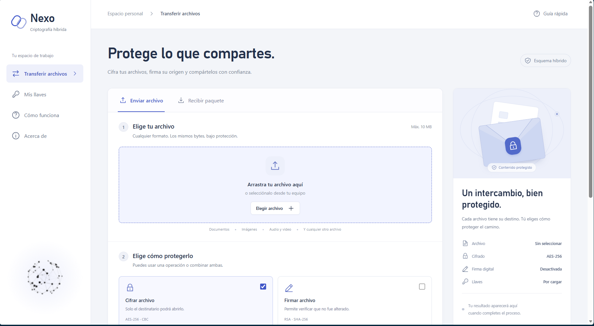
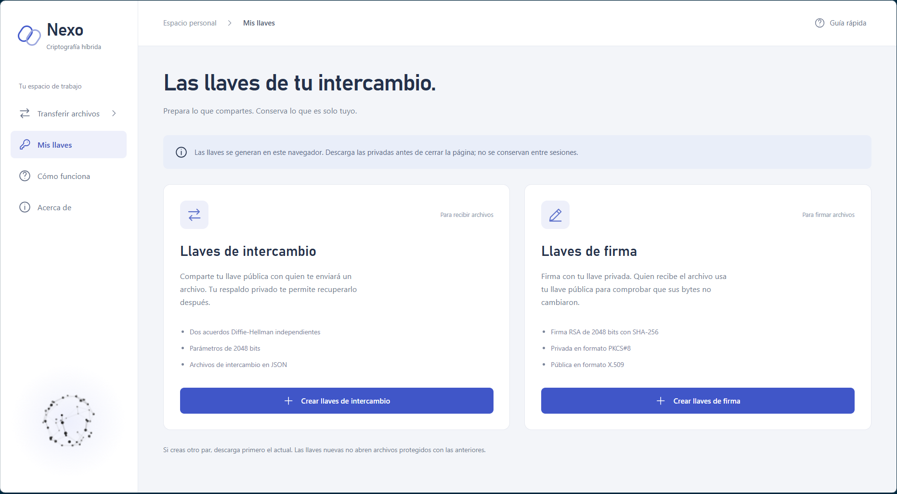
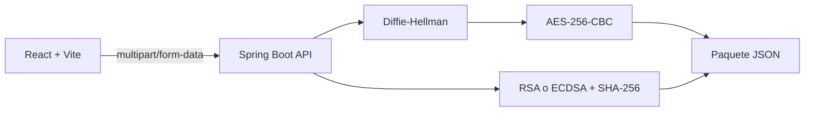

# Nexo · Criptografía híbrida

<p align="center">
  Aplicación académica para proteger archivos mediante intercambio de llaves, cifrado y firma digital.
</p>

<p align="center">
  <a href="#características">Características</a> ·
  <a href="#ejecución-local">Ejecución local</a> ·
  <a href="#uso">Uso</a> ·
  <a href="#despliegue">Despliegue</a>
</p>

> Proyecto académico de la Escuela Superior de Cómputo (ESCOM) del Instituto Politécnico Nacional (IPN).

## Vista previa


## Características

- Cifrado de archivos con AES-256-CBC derivado de un intercambio Diffie-Hellman.
- Firma y verificación con RSA-2048 o ECDSA P-256, ambos con SHA-256.
- Flujos independientes: cifrar, firmar, descifrar o verificar; también se pueden combinar.
- Paquetes JSON transportables que preservan archivos binarios sin modificar sus bytes.
- Generación y lectura de llaves PEM RSA/ECDSA y parámetros de intercambio en el navegador mediante Web Crypto.
- Interfaz React accesible en español, adaptada para escritorio y móvil.
- Descarga bloqueada cuando una firma no supera la verificación de integridad.

## Arquitectura



El frontend prepara las llaves y solicitudes. El backend procesa exclusivamente arreglos binarios, genera el paquete JSON o devuelve el archivo recuperado. Las llaves privadas y los resultados se mantienen en memoria durante la sesión del navegador.

## Tecnologías

| Capa | Tecnología |
| --- | --- |
| Interfaz | React 19, TypeScript, Vite y Thinking Orbs |
| API | Java 21 y Spring Boot 4 |
| Criptografía | Diffie-Hellman, AES/CBC/PKCS5Padding, RSA o ECDSA/SHA-256 |
| Contenedores | Docker y Docker Compose |

## Ejecución local

### Requisitos

- Docker Desktop activo, con contenedores Linux y Docker Compose v2.
- PowerShell para `run.ps1` (incluido en Windows).
- Internet durante la primera compilación para descargar imágenes y dependencias.

**No necesitas instalar Java, Maven, Node.js, npm ni una base de datos.** La compilación de React, las pruebas y el empaquetado de Spring Boot ocurren en Docker. Las llaves se generan en el navegador y no se guardan en la imagen ni en volúmenes.

### Iniciar todo

Desde la raíz del proyecto:

```powershell
.\run.ps1
```

Abre **http://localhost:8080**. La interfaz y la API se sirven desde el mismo contenedor; no hace falta iniciar Vite ni otra terminal. El script reconstruye cuando hay cambios y espera a que el contenedor esté saludable; un error detiene la ejecución.

Si Windows bloquea scripts, puedes ejecutarlo sin cambiar la política permanentemente:

```powershell
powershell -ExecutionPolicy Bypass -File .\run.ps1
```

```powershell
.\run.ps1 up -Port 9090  # Puerto alternativo
.\run.ps1 logs           # Seguir registros
.\run.ps1 status         # Estado de los contenedores
.\run.ps1 down           # Detener y retirar contenedores
```

El servicio se enlaza a `127.0.0.1` por defecto. Para publicar en otra interfaz configura `NEXO_BIND_ADDRESS` y utiliza HTTPS. No se requieren archivos `.env` ni claves preexistentes.

## Uso

1. El destinatario crea y descarga su intercambio de llaves desde **Mis llaves**. Comparte solo el archivo público.
2. En **Mis llaves**, el remitente elige **RSA** o **ECDSA P-256** y genera y descarga su par de firma. También puede cargar llaves existentes: privada PKCS#8 sin contraseña y pública X.509 (SPKI), ambas en PEM.
3. En **Enviar archivo**, elige cifrado, firma o ambos. Carga la privada de firma; se valida y detecta su algoritmo automáticamente. Comparte el paquete JSON y solo la llave pública de firma.
4. El destinatario carga el paquete, su respaldo privado Diffie-Hellman y, si aplica, la llave pública RSA o ECDSA del remitente. El algoritmo de verificación se lee del paquete.
5. Nexo recupera el archivo solo si las operaciones solicitadas se completan. Cuando la firma no coincide, bloquea la descarga.

No compartas respaldos ni llaves privadas. Las llaves PEM necesarias se envían a la API para procesar el archivo y no se persisten. Para un sitio público usa HTTPS: las APIs criptográficas del navegador requieren un contexto seguro fuera de `localhost`.

Los paquetes RSA anteriores siguen funcionando. ECDSA utiliza la curva P-256 (`secp256r1`), SHA-256 y firmas ASN.1 DER. No se admiten privadas SEC1 (`BEGIN EC PRIVATE KEY`) ni curvas diferentes de P-256.

## API y límites

| Ruta | Método | Descripción |
| --- | --- | --- |
| `/api/crypto/process` | `POST` | Cifra, firma o combina ambas operaciones y devuelve un paquete JSON. |
| `/api/crypto/verify-decrypt` | `POST` | Verifica, descifra o combina ambas operaciones y devuelve el archivo recuperado. |

Las solicitudes son `multipart/form-data`. El archivo de entrada admite hasta 10 MiB; un paquete recibido, hasta 16 MiB; y una llave PEM, hasta 64 KiB. Las respuestas usan `400` para solicitudes inválidas, `413` para tamaños excedidos y `422` para errores de integridad.

Para firmar, `options.signatureAlgorithm` acepta `RSA` (predeterminado) o `ECDSA`. Los paquetes ECDSA incluyen `signature_algorithm: "ECDSA"`; sin ese campo se interpreta RSA. La recepción no necesita indicar el algoritmo. La firma cubre los bytes originales, no los nombres ni los metadatos.

## Verificación

Toda la verificación se ejecuta en contenedores:

```powershell
.\run.ps1 test
```

Incluye lint, pruebas y build del frontend, pruebas Maven del backend e integración HTTP real con RSA y ECDSA, cifrado opcional, preservación binaria y rechazo de firmas alteradas y llaves incorrectas. Si falla alguna prueba, el script termina con error. Al finalizar, la aplicación permanece activa; detenla con `.\run.ps1 down`.

## Despliegue

El proyecto incluye una imagen multietapa que compila la interfaz y la sirve desde Spring Boot, además de un archivo `compose.yaml` con límites de memoria, sistema de archivos de solo lectura y health check.

```sh
docker compose up --build -d --wait nexo
```

La imagen final solo contiene el JRE y la aplicación compilada; Node.js y Maven permanecen en las etapas de construcción. Los servicios del perfil `test` solo se ejecutan al solicitarlos, no en el arranque normal. Para probar sin PowerShell: `docker compose --profile test run --build --rm integration-tests` (construye y levanta también la aplicación).

## Autores

- Carmona Marinez Ricardo
- Diaz Torres Jonathan Samuel
- Velazquez Parral Saul Asaph

Escuela Superior de Cómputo · Instituto Politécnico Nacional
